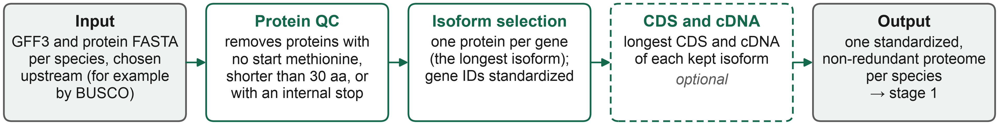
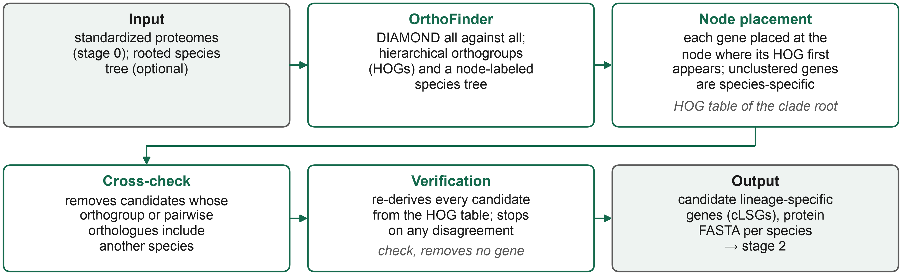
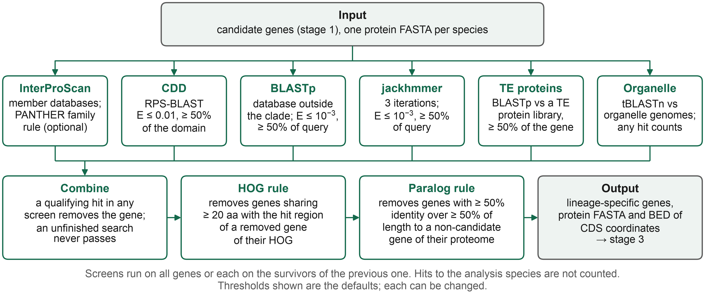
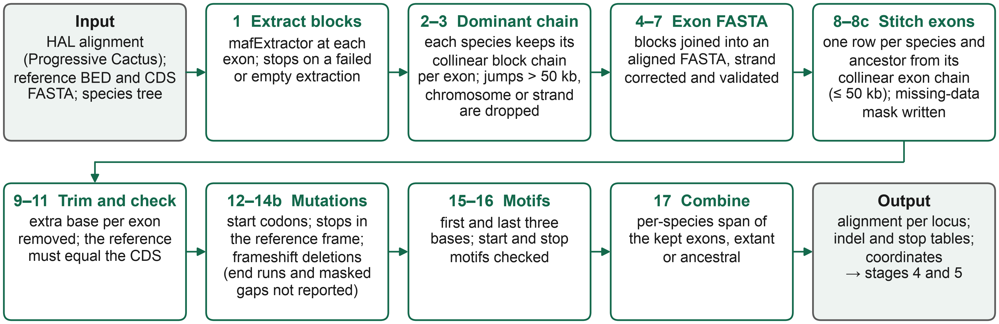
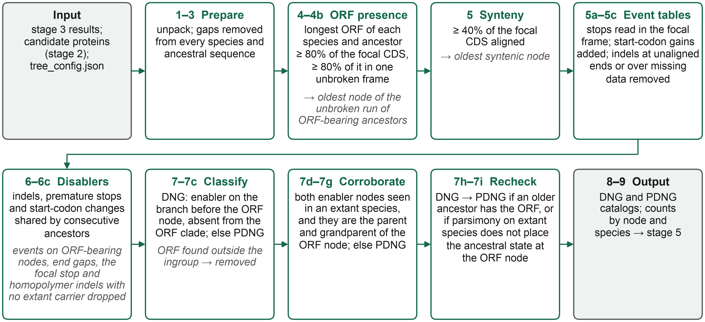
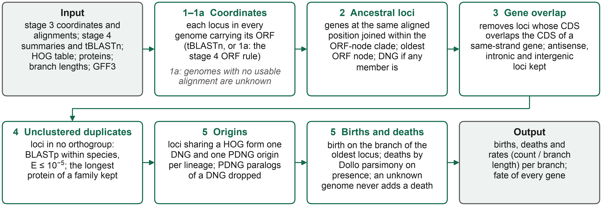

# LINGUA: LINeage-specific Gene Uniform Annotator

LINGUA identifies candidate de novo genes across a clade, extracts their syntenic regions
from a reference-free whole-genome alignment, and classifies each locus as a de novo gene
with an enabler mutation placed on the phylogeny (DNG) or a putative de novo gene (PDNG).
It was developed for, and used in,

> Owoyemi A. O., Sanders S. C., Chaison C. A., Marano M. A. & Casola C. Phylogenomic
> reconstruction across the Brassicaceae reveals the tempo, genomic determinants, and
> functional emergence of de novo genes. (manuscript; citation to be added on publication)

## Tutorial

New to LINGUA? Start with the tutorial in [`docs/tutorial/`](docs/tutorial/README.md). It installs one conda environment
and runs every stage on a small worked example in seconds, including seven *Arabidopsis thaliana* genes from the paper
followed from their alignment to the branch where they were born.

## Stages

LINGUA runs in four stages, numbered 1 to 4, preceded by a preparatory stage 0 that standardizes the input
proteomes and followed by a summary stage (folder `5_birth_death/`) that turns the classified loci into birth and
death rates. Each folder is self-contained, with its own README, scripts and example or
reference data, and the output of each stage is the input of the next.

| Stage | Folder | What it does | Main output |
|---|---|---|---|
| 0 | [`0_protein_preprocessing/`](0_protein_preprocessing/) | Protein quality control and longest-isoform selection from per-species GFF and protein FASTA files | One standardized, non-redundant proteome per species |
| 1 | [`1_gene_stratigraphy/`](1_gene_stratigraphy/) | Places every gene on the species tree from OrthoFinder hierarchical orthogroups, extracts candidate lineage-specific genes and verifies each against the HOG table | Candidate de novo gene (cDNG) sequences per species |
| 2 | [`2_homolog_exclusion/`](2_homolog_exclusion/) | Removes candidates with a known protein domain (InterProScan, RPS-BLAST against CDD), a homolog outside the clade (BLAST+, jackhmmer), an organelle-derived origin, or similarity to transposable-element proteins over at least half of their length (BLASTp against a TE protein library), then candidates homologous to the hit region of a removed gene in their OrthoFinder HOG (`hog-rule`) and candidates with a similar established gene in their own proteome (`paralog-rule`); `2_homolog_exclusion/scripts/run_stage2.sh` runs all of them. The study's exact protocol is `2_homolog_exclusion/STAGE2_PROTOCOL.md` | Candidates with no evidence of homology outside the clade |
| 3 | [`3_alignment_extraction/`](3_alignment_extraction/) | Extracts each candidate locus, in every species and in the ancestral genomes reconstructed by Progressive Cactus, from the HAL alignment with mafExtractor, removes alignment and extraction artifacts, stitches exons and tabulates start, stop and frameshift changes per species | Per-species, exon-stitched alignments with indel and stop-codon tables |
| 4 | [`4_enablers/`](4_enablers/) | Scores intact ORFs, synteny and disablers on every species and on the Progressive Cactus ancestral sequences of every internal node, places enablers and classifies DNGs and PDNGs | Per-species node summaries and family-wide DNG and PDNG catalogs |
| Summary | [`5_birth_death/`](5_birth_death/) | Groups the classified genes of different species into ancestral loci, removes loci whose coding exons overlap those of another gene on the same strand, collapses duplicated loci into one origin (shared orthogroup, unclustered duplicates, PDNG paralogs of a DNG), and counts births and Dollo-parsimony deaths on every branch | Births, deaths and their rates per branch, with the fate of every gene |

Stage 2 removes the loci with domain or transposable-element evidence, so stage 4 runs on its output with an empty
`REMOVE_LIST` (`REMOVE_LIST=`). The stage 4 default, `4_enablers/data/lsgs_to_remove.txt`, lists the loci removed
in the earlier run tagged `paper-published`, whose stage 2 did not yet screen every candidate.

Each stage has its own software requirements, listed in its README. `environment.yml` at the top level is the
conda environment for stage 4.

## Reproducing the published analysis

Release v1.2.0 is the code of the paper's catalog (v1.2.1 changes only the documentation), 32,210 lineage-specific genes in 23 genomes, of which 2,375
DNGs and 24,581 PDNGs in the 20 core Brassicaceae. Stage 2 followed `2_homolog_exclusion/STAGE2_PROTOCOL.md`;
stages 3 and 4 ran with their default settings (stage 3 `STEP3=dominant`, `JUMP=50000`, `MAXSPAN=50000`; stage 4
default method options and tree configuration, empty `REMOVE_LIST`); the summary stage ran with `PRESENCE=orf`, leaving out
loci whose ORF node is N2 or N3. The catalog and the alignments it was called from are in the data record below.

The tag `paper-published` (commit `f2e5a02`) marks the stage 4 code of an earlier version of the catalog (1,811
DNGs), whose rules are kept as `4_enablers/presets/method_options_brassicaceae_published.json`.

## Workflow figures

One figure per stage, with the default thresholds and no counts from any dataset. `docs/figures/` holds them as PNG and
SVG and all six as slides in `LINGUA_workflows.pptx`; `docs/figures/make_workflows.py` redraws them.

**Stage 0, protein preprocessing**

**Stage 1, gene stratigraphy**

**Stage 2, homolog exclusion**

**Stage 3, alignment extraction**

**Stage 4, enablers**

**Summary stage, births, deaths and rates**

## Data

- Progressive Cactus alignment of 21 Brassicaceae and two outgroups,
  https://doi.org/10.5281/zenodo.22137464
- Proteomes, OrthoFinder results and the stage 2 screen of every candidate, https://doi.org/10.5281/zenodo.22926477
- De novo gene catalog and gap-free alignments, https://doi.org/10.5281/zenodo.22926716

The two DOIs above resolve to the latest version of each record.

## Related tools

The paper also used two tools by A. O. Owoyemi that are maintained separately, IGOR, which extracts
intergenic ORFs (https://github.com/Ludtson/IGOR), and SeqMetrics, which computes sequence features
(https://github.com/Ludtson/SeqMetrics). Both are archived at https://doi.org/10.5281/zenodo.23089299.

## Authors

Stages 0 to 2, Adekola O. Owoyemi. Stage 3, Sierra C. Sanders. Stage 4, the Casola Lab.
Stages 0 to 3 were developed in separate repositories
([protein-preprocessing-isoform-pipeline](https://github.com/Ludtson/protein-preprocessing-isoform-pipeline),
[gene-stratigraphy-pipeline](https://github.com/Ludtson/gene-stratigraphy-pipeline),
[homolog-exclusion-pipeline](https://github.com/Ludtson/homolog-exclusion-pipeline),
[progressive-cactus-gene-analysis-pipeline](https://github.com/sierras64/progressive-cactus-gene-analysis-pipeline))
and were merged here with their full commit history.

## License

MIT, see `LICENSE`. This applies to every stage.

## Contact

Casola Lab, Department of Ecology and Conservation Biology, Texas A&M University
(ccasola@tamu.edu).
