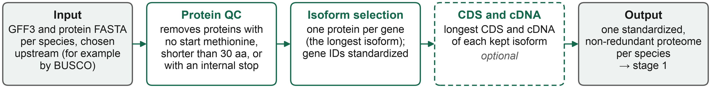

# 01 Stage 0, protein preprocessing



Stage 0 turns the annotation of each species into one clean protein per gene, which is what OrthoFinder needs in
stage 1. It removes proteins without a starting methionine, proteins shorter than 30 amino acids and proteins with an
internal stop codon, then keeps the longest remaining isoform of every gene. Choosing the species and checking genome
completeness (for example with BUSCO) happens before this stage.

## Input

One GFF and one protein FASTA per species, in two folders, paired by file name (`Athaliana.gff` goes with
`Athaliana.faa`). The example in `0_protein_preprocessing/example_data/` holds real proteomes of *Arabidopsis thaliana*,
*Arabidopsis lyrata* and *Brassica oleracea* with reduced GFF files (the first 5,000 lines of each). Only genes present
in the GFF reach the output, so the run keeps 1,578 proteins out of 137,211 cleaned ones, and the "Isoform reduction
rate" of 98.85% in the log reflects the reduced GFF files, not isoforms. On a complete annotation the output holds one
protein per protein-coding gene.

## Run

```bash
cd 0_protein_preprocessing
bash scripts/longest_protein_pipeline.sh \
  -g example_data/gff \
  -f example_data/protein \
  -o ../tutorial_runs/stage0
cd ..
```

## Check that it worked

```bash
diff tutorial_runs/stage0/master_summary_report.tsv \
     0_protein_preprocessing/example_data/test_run/master_summary_report.tsv && echo "stage 0 OK"
```

No difference means your run reproduced the expected result.

## Output

| File or folder | What it holds |
|---|---|
| `master_summary_report.tsv` | one row per species, the counts at every step (see below) |
| `1_cleaned_proteins/` | proteins that passed the three quality filters |
| `2_qc_details/` | per-species details of the quality filters |
| `3_isoform_details/`, `4_longest_proteins/` | the isoform selection and the longest protein of each gene |
| `5_final_proteins/` | **the result**, one protein per gene per species (`<species>_final.faa`), the input of stage 1 |
| `master_longest_isoforms.tsv` | the isoform kept for every gene |
| `pipeline.log`, `logs/` | what ran, with warnings |

In `master_summary_report.tsv`, `S` counts proteins removed for an internal stop, `noM` for a missing start methionine
and `<30` for length, and the combined columns (`S/noM` and so on) count proteins with more than one defect.
`N_Cleaned_Proteins` and `N_Isoform_Step_Input` are counted by two different steps and must be equal. If they differ for
a species, the isoform step read a different file than the cleaning step wrote, and that species needs checking.

## On your own data

- Put one GFF and one protein FASTA per species in two folders with matching names. Accepted extensions are `.faa`,
  `.fa` or `.fasta` for proteins and `.gff` or `.gff3` for annotations.
- When the species names differ from the file names, give a species map with `-m` (see the stage README).
- `--format-headers --add-species` adds the species name to every FASTA header, which makes later stages easier to read.
- A species with a missing file is skipped with a warning in `pipeline.log`, not an error. Always check that every
  species appears in `master_summary_report.tsv`.

Stage README with every option, [`0_protein_preprocessing/README.md`](../../0_protein_preprocessing/README.md).
Next, [02 Gene stratigraphy](02_stage1_stratigraphy.md).
