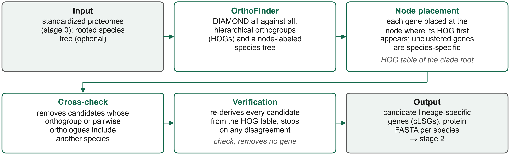

# 02 Stage 1, gene stratigraphy



Stage 1 places every gene on the species tree. OrthoFinder groups the proteins of all species into hierarchical
orthogroups (HOGs), and stage 1 reads them to find the genes found in one species only, the candidate lineage-specific
genes (cLSGs). A candidate is either *clustered* (in a HOG with no other species) or *unclustered* (in no HOG at all).
Two checks then remove candidates that only look lineage-specific because the HOG table cannot see a related gene,
namely a check against OrthoFinder's flat orthogroups and one against its pairwise orthologs. Finally an independent
verifier re-derives every call from the HOG table.

Stage 1 has two separate commands. `scripts/run_orthofinder.sh` runs OrthoFinder, which is slow and is usually a
cluster job. `bin/OrthoFinderDataProcessor.py` classifies its output in seconds. The worked example starts from a
finished OrthoFinder run.

## The example

`1_gene_stratigraphy/example_data/` is a synthetic OrthoFinder run on three species, `(Outgroup,(SpeciesA,SpeciesB)N1)N0`.
*SpeciesA* has four genes, and each one shows a different outcome.

| Gene | In the HOG table (`N1.tsv`) | Final call |
|---|---|---|
| `gene_a1` | HOG with `gene_b1` of *SpeciesB* | not a candidate, the gene dates to N1 |
| `gene_a2` | HOG with no other species | removed by the cross-check, because its orthogroup in `Orthogroups.tsv` holds an outgroup gene |
| `gene_a3` | in no HOG | removed by the cross-check, because it has a pairwise ortholog in the outgroup (`gene_o2`) |
| `gene_a4` | in no HOG | **candidate lineage-specific gene** |

`N1.tsv` is used instead of `N0.tsv` because the outgroup sits outside N1. Any species outside the chosen HOG node is
invisible to the HOG table, which is exactly what the cross-check protects against.

## Run

```bash
cd 1_gene_stratigraphy
python3 bin/OrthoFinderDataProcessor.py ../tutorial_runs/stage1 \
  --orthofinder_dir example_data/orthofinder \
  --prt_dir example_data/protein \
  --hog-filename N1.tsv
cd ..
```

The last lines of the screen output should read `Violations found: 0` and `[PASS] All checked cLSGs are consistent with
the HOG table.`

## Check that it worked

```bash
mv tutorial_runs/stage1/OrthoFinderDataProcessor.log tutorial_runs/stage1.log
diff -r tutorial_runs/stage1 1_gene_stratigraphy/example_data/expected_output && echo "stage 1 OK"
```

The log is moved out first because it is not part of the expected output.

## Output

| File or folder | What it holds |
|---|---|
| `C_LSG_Iso.tsv` | every gene of every species with its node (`N1`, `species_specific_clustered`, `species_specific_unclustered` and so on) and its HOG |
| `cross_check_exclusions.tsv` | every candidate the cross-check removed, which check removed it and the conflicting species or gene |
| `global_summary.csv` | one row per species, with `total_candidate_percentage` (before the cross-check) and `verified_candidate_percentage` (after) |
| `clsg_verification_report.tsv` | candidates that disagree with the HOG table, header only when there are none |
| `<species>/gene_IDs_by_node/<species>_candidate_lsg_gene_ids.txt` | the final candidate list |
| `<species>/proteins_by_node/<species>_candidate_LSGs_proteins.faa` | **the result**, candidate proteins, the input of stage 2 |

In the example, *SpeciesA* goes from 75% candidates before the cross-check (three of four genes) to 25% after it
(`gene_a4` only).

## On your own data

1. Run OrthoFinder on the stage 0 proteins, ideally with your rooted species tree:
   `bash scripts/run_orthofinder.sh -i <stage0 final proteins> -o <out> -t 16 [-s rooted_tree.nwk]`.
2. Open `Species_Tree/SpeciesTree_rooted_node_labels.txt` and choose the HOG file of the node that holds every species of
   your ingroup (`N0.tsv` when there is no outgroup, often `N1.tsv` with one).
3. Point `--prt_dir` at the `protein/` folder that `run_orthofinder.sh` made, not at the stage 0 folder. The species
   names there match OrthoFinder's own, and a mismatch only logs a warning while unclustered genes of that species go
   undetected.
4. A run that ends with a verification failure exits with status 1. Do not use its candidates until the report is empty.

Stage README, [`1_gene_stratigraphy/README.md`](../../1_gene_stratigraphy/README.md).
Next, [03 Homolog exclusion](03_stage2_homolog_exclusion.md).
