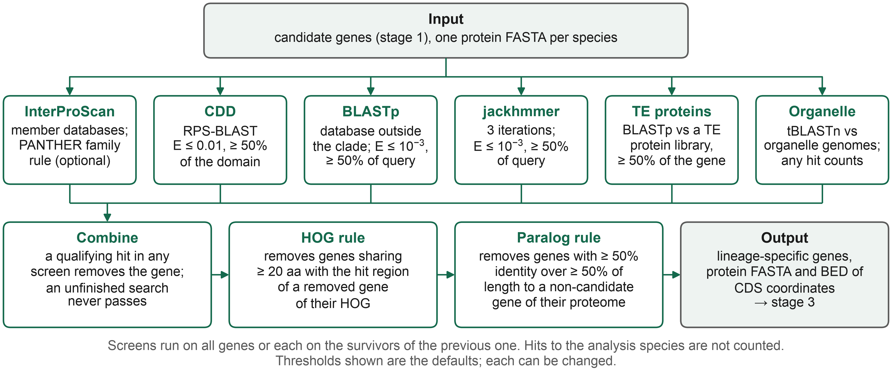

# 03 Stage 2, homolog exclusion



A gene found in one clade only is not necessarily new. It may have a homolog elsewhere that OrthoFinder missed, carry a
known protein domain, come from a transposable element or from the organelle genome. Stage 2 searches every candidate
against each of these sources and keeps only the candidates with no evidence of homology. It runs six screens (BLASTp
and jackhmmer against proteins from outside the clade, RPS-BLAST against CDD, InterProScan, BLASTp against
transposable-element proteins and tBLASTn against organelle genomes), combines them, and then applies two rules,
namely the HOG rule (a candidate that shares a HOG with a removed gene and aligns to its hit region is removed too) and
the paralog rule (a candidate with a similar established gene in its own proteome is removed).

## The example

`2_homolog_exclusion/example_data/run_stage2_toy/` is the hand-built example of the stage 2 test suite, with two
species (*Testa alpha* and *Testb beta*) and seven candidates whose fate was worked out by hand.

| Candidate | Built as | Removed by |
|---|---|---|
| `cand1` | a protein that the database holds in *Homo sapiens* and *Mus musculus* | BLASTp and jackhmmer |
| `cand3` | the first 40 amino acids of `cand1` plus unrelated sequence, in the same HOG as `cand1` | HOG rule |
| `cand4` | a protein whose proteome also holds a close copy (`G2`) that is not a candidate | paralog rule |
| `cand7` | a transposable-element protein | TE screen |
| `cand8` | encoded in the organelle genome | organelle screen |
| `cand5`, `cand6` | unrelated sequence | **pass** |

The CDD screen is left out (`SKIP_SCREENS=cdd`), and InterProScan is replaced by a stand-in that never finds a domain,
so the example needs only BLAST+ and HMMER.

## Run

Build the three small BLAST databases once, then run the whole stage with its driver.

```bash
T=2_homolog_exclusion/example_data/run_stage2_toy
makeblastdb -in $T/db/animals.faa -dbtype prot -out $T/db/animals.faa
makeblastdb -in $T/db/te.faa      -dbtype prot -out $T/db/te.faa
makeblastdb -in $T/db/org.fna     -dbtype nucl -out $T/db/org.fna
bash 2_homolog_exclusion/scripts/run_stage2.sh $T/toy_stage2.conf
```

The driver reads every path and setting from `toy_stage2.conf` (open it, it is short) and ends with
`SUCCEEDED steps 1-9 (screens left out: cdd)`.

## Check that it worked

```bash
cat tutorial_runs/stage2/STATUS
cat tutorial_runs/stage2/paralog/passed_ids.tsv
```

`passed_ids.tsv` must list `cand5` (*Testa alpha*) and `cand6` (*Testb beta*) only. To see why each other candidate went,
look at the three tables below.

```bash
cut -f1,2 tutorial_runs/stage2/combine/gene_matrix.tsv | head -1
awk -F'\t' 'NR==1{for(i=1;i<=NF;i++)h[$i]=i; next}{print $h["gene_id"], $h["verdict"], $h["removed_by"]}' \
    tutorial_runs/stage2/combine/gene_matrix.tsv
grep REMOVED tutorial_runs/stage2/hog/hog_rule.tsv tutorial_runs/stage2/paralog/paralog_rule.tsv
```

`gene_matrix.tsv` shows `cand1` removed by `blast;jackhmmer`, `cand7` by `te` and `cand8` by `organelle`. `cand3` and
`cand4` still pass the screens there and are removed afterwards, `cand3` in `hog_rule.tsv` (`REMOVED_HOG`, through
`cand1`) and `cand4` in `paralog_rule.tsv` (`REMOVED_PARALOG`, through `G2`).

## Output

| File or folder | What it holds |
|---|---|
| `STATUS` | `SUCCEEDED steps 1-9` with any screens left out, or `FAILED at step N` |
| `blast/`, `jackhmmer/`, `interpro/`, `te/`, `organelle/` (and `cdd/`) | one folder per screen, each with its own hits and `run.json` (tool versions and settings) |
| `combine/gene_matrix.tsv` | one row per candidate with the result of every screen, `verdict` and `removed_by` |
| `hog/hog_rule.tsv`, `paralog/paralog_rule.tsv` | the two rules, with the gene that caused each removal |
| `paralog/passed/`, `paralog/passed_ids.tsv` | **the result**, the candidates that passed, one FASTA per species, the input of stage 3 |
| `stepN.log` | the log of each step |

A gene whose search did not finish is never counted as "no hit". It is marked `NOT_RUN` or `NOT_SEARCHED`, does not
pass, and the run stops as `FAILED`.

## On your own data

- Copy `2_homolog_exclusion/presets/stage2_run.conf.example`, fill in your paths and run
  `bash 2_homolog_exclusion/scripts/run_stage2.sh my_stage2.conf`.
- The databases matter more than any setting. A protein database that contains your own species makes every candidate
  "find a homolog" in itself. Stage 2 warns when it sees an analysis species inside a database, and
  `2_homolog_exclusion/docs/databases.md` explains how to build databases for a clade.
- InterProScan and CDD are large installs, described in `2_homolog_exclusion/docs/setup.md`. Leave a screen out only with
  a reason (for example `SKIP_SCREENS=organelle` for a clade without organelle genomes); `STATUS` records it.
- The exact protocol of the paper is `2_homolog_exclusion/STAGE2_PROTOCOL.md`.

Stage README, [`2_homolog_exclusion/README.md`](../../2_homolog_exclusion/README.md).
Next, [04 Alignment extraction](04_stage3_alignment_extraction.md).
