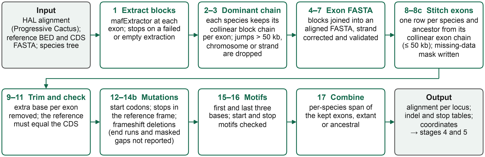

# 04 Stage 3, alignment extraction



To determine whether a candidate is a de novo gene, LINGUA needs to see its locus in every other species and in every
ancestor. Those sequences come from a Progressive Cactus whole-genome alignment, which also reconstructs the genome of
every internal node of the tree. Stage 3 cuts each candidate's coding exons out of the alignment (step 1, with
`mafExtractor`), removes blocks that jump far away on the chromosome or switch strand, stitches the exons into one row per
species and ancestor, checks that the reference row equals the candidate's CDS, and tabulates start codons, stop
codons and frameshift-length deletions relative to the reference. One run handles one reference (focal) species.

## The example

`3_alignment_extraction/example_data/` holds the seven *A. thaliana* candidates of the tutorial (12 coding exons), as
they went through stage 3 in the paper.

| File | What it is |
|---|---|
| `Arabidopsis_thaliana_tutorial.bed` | the CDS exons of the seven candidates (chrom, 0-based start, end, name, score, strand, transcript ID) |
| `Arabidopsis_thaliana_tutorial_cds.fna` | their CDS sequences, named by transcript ID |
| `species_tree.nwk` | the tree of the 23 genomes with the internal node labels of the Cactus alignment |
| `step1/` | the step 1 output of the paper, one MAF extraction per exon (`Arabidopsis_thaliana.<chrom>_<start>_<end>.txt`) |
| `expected/` | the expected output of steps 8c to 14 and step 17 for these loci (see the note below the check) |

Running step 1 needs the 23-genome alignment (hundreds of GB), so the example starts from its output with `STEP1_SRC`.
Everything from step 2 onward runs for real.

## Run

```bash
E=3_alignment_extraction/example_data
STEP1_SRC=$E/step1 ENV_BIN="$(dirname "$(command -v python3)")" THREADS=2 FLOOR_GB=1 \
  bash 3_alignment_extraction/run_stage3.sh tutorial_runs/stage3 Arabidopsis_thaliana \
    $E/Arabidopsis_thaliana_tutorial.bed $E/Arabidopsis_thaliana_tutorial_cds.fna - $E/species_tree.nwk
```

- The `-` in place of the MAF file says that step 1 is copied from `STEP1_SRC`.
- `ENV_BIN` tells the driver which Python to use (the one of the active environment).
- `FLOOR_GB=1` lowers the free-disk check, which by default refuses to start with less than 50 GB free.

## Check that it worked

```bash
cat tutorial_runs/stage3/STATUS          # SUCCEEDED <date>
( cd 3_alignment_extraction/example_data/expected &&
  for f in step*/* step17_all_species.tsv; do cmp -s "$f" "../../../tutorial_runs/stage3/$f" || echo "DIFFERS $f"; done )
```

No `DIFFERS` line means every alignment and table matches the expected output. The step 8c, 9, 12 and 17 files are
those of the paper's run. The step 13 and 14 files come from the current scripts, which drop the stops outside the
reference reading frame and the deletions that come from unaligned ends or missing data. The paper's run applied the same
filters later, at stage 4 steps 5a and 5c, so its step 13 and 14 tables are longer, and the stage 4 result is the same
either way (for these seven loci, stage 4 run on either set of tables gives identical final tables). Also check the files the stage README lists under
"What to check after a run", in particular that `step1_missing.txt` and `step1_problems.tsv` are empty and that
`step9/step9_trimming_report.tsv` refused no file.

## Output

| File or folder | What it holds |
|---|---|
| `STATUS`, `PROVENANCE.txt` | the verdict of the run, and its inputs with checksums, options and tool paths |
| `step8c/` | one stitched alignment per candidate, one row per species and ancestor, and the missing-data mask |
| `step9/*.aln` | **the alignments stage 4 reads**, with the extra base per exon removed; the reference row equals the CDS |
| `step12/`, `step13/`, `step14/` | start codons, stop codons in the reference frame, and frameshift-length deletions, per candidate, with `master_*.tsv` tables of all candidates |
| `step14_deletion_evidence.tsv` | for every reported deletion, where its gap came from and whether the species has sequence there |
| `step17_all_species.tsv` | the genomic span of each candidate in every species and ancestor |

Open one alignment to see what stage 4 will work with, for example
`tutorial_runs/stage3/step9/Arabidopsis_thaliana_AT5G39570.2_chr5_15844138_15845960.aln` (*PLDRP1*). It has 45 rows,
one for each of the 23 species and the 22 ancestors (N0 to N21), each named by species or node and the sequence it
came from; gaps are deletions relative to *A. thaliana*.

## From stage 3 to stage 4

Stage 4 does not read the stage 3 work folder directly. It expects the `step9` alignments, the `step13` stop table, the
`step14` indel table, the first five columns of `step17` and the candidate proteins in a layout of its own (shown in
[05 Enablers](05_stage4_enablers.md)). `4_enablers/scripts/stage3_to_stage4.py` copies one stage 3 run into that layout.
It refuses a run whose `STATUS` is not `SUCCEEDED`, a species that does not match the alignments, and tables or
alignments that do not match each other, and it gives every protein the transcript ID of its alignment.

```bash
python3 4_enablers/scripts/stage3_to_stage4.py tutorial_runs/stage4_from_stage3 tutorial_runs/stage3 athaliana \
  4_enablers/example_data/workdir/clsgs_45k_1line/Athaliana.longest_per_gene_header_extracted.oneline.faa
```

The arguments are the stage 4 work folder, the stage 3 work folder, the species as its `query_prefix` in
`4_enablers/data/species.tsv` (or the table in `SPECIES_TSV`) and the candidate proteins. The script derives every file
and folder name stage 4 needs from that table and the tree configuration. With several reference species, run it once
per stage 3 run into the same stage 4 work folder, then list them all in `ONLY` when you run stage 4. [05 Enablers](05_stage4_enablers.md) runs stage 4 on the
result.

## On your own data

1. Build the alignment with Progressive Cactus (`cactus` on a cluster), then convert it to a MAF anchored on your
   reference species with `hal2maf`.
2. Write the BED of your stage 2 candidates. `bash 2_homolog_exclusion/scripts/homolog_exclusion_pipeline.sh make-bed`
   turns an ID list and a GFF3 into CDS coordinates. Stage 3 needs seven columns, the last one the transcript ID, and
   0-based starts; the run stops before step 14 if it detects a 1-based BED.
3. Write the CDS FASTA (`3_alignment_extraction/scripts/build_cds_from_genome.py genome.fa candidates.bed proteins.faa out.fna report.tsv`
   builds it from the genome, which needs a samtools index, and the BED, and checks each translation against the
   proteins; it needs samtools).
4. Run `run_stage3.sh` with the MAF in place of `-` and no `STEP1_SRC`. With thousands of candidates, run it detached
   (`nohup`, see `3_alignment_extraction/docs/run_stage3_README.txt`), and repeat it for every reference species.
5. Copy every run into one stage 4 work folder with `stage3_to_stage4.py`, as above, and run stage 4 from step 2 with
   `ONLY` listing those species (`ONLY` can be left out only when every species of `species.tsv` is there).

Stage README, [`3_alignment_extraction/README.md`](../../3_alignment_extraction/README.md).
Next, [05 Enablers](05_stage4_enablers.md).
