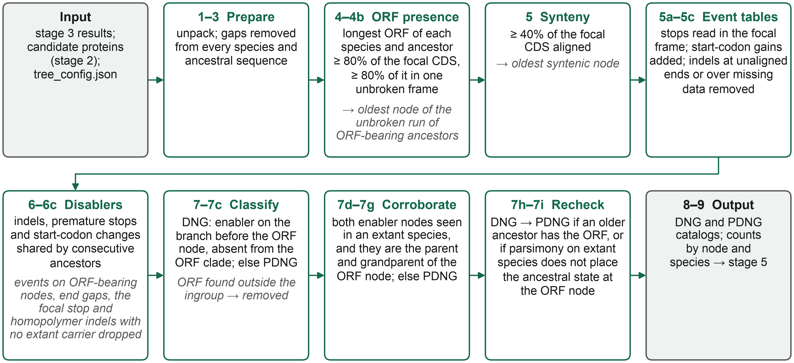

# 05 Stage 4, enablers



Stage 4 determines, for every candidate, when its open reading frame (ORF) appeared and whether the mutation that opened
it can be placed on the tree. Working on the stage 3 alignment of each candidate, it finds

- the **ORF node**, the oldest ancestor in an unbroken run of ancestors that carry the ORF (at least 80% of the
  candidate's CDS length, at least 80% of it in one unbroken frame);
- the **synteny node**, the oldest ancestor in which at least 40% of the CDS is aligned;
- the **disablers**, frameshifting indels and premature stop codons shared by consecutive ancestors, which break the
  ORF in older sequences. Removing a disabler is what opened the ORF, so a disabler seen from the young side is an
  **enabler**.

A candidate is a **DNG** when its enablers sit on the parent and the grandparent of the ORF node and are corroborated by
extant genomes, and a **PDNG** (putative de novo gene) otherwise. Candidates whose ORF also exists in an ancestor
outside the ingroup are removed.

## The example

`4_enablers/example_data/workdir/` is the stage 4 input of the seven tutorial genes, in the layout stage 4 expects.

```
workdir/
  brassicaceae_23species_LINGUA_results/
    Athaliana_DNG_45k_cds_stitched_exons_version3_nomafft_final/   the 7 step 9 alignments of stage 3
  stops_dir/Athaliana_..._stop_codon_summary.tsv                   stage 3 step 13 table of those alignments
  indels_dir/Athaliana_..._indels_summary.tsv                      stage 3 step 14 table
  coordinates_alignments_all_species/Athaliana_..._all_species_summary.tsv   stage 3 step 17, first 5 columns
  clsgs_45k_1line/Athaliana.longest_per_gene_header_extracted.oneline.faa    the 7 candidate proteins
```

Stage 4 finds the alignment folder and the two tables of a species by their content (the alignment and row names start
with the species name, here `Arabidopsis_thaliana_`), so what matters in the names is the file suffixes
(`_stop_codon_summary.tsv`, `_indels_summary.tsv`, `_all_species_summary.tsv`) and the short species prefix that starts
the alignment folder name and the protein file name (`Athaliana`). Step 2 turns that prefix into the gap-free folder
`athaliana_stitched_nogaps`, the name `4_enablers/data/species.tsv` lists for the species. `logs/stage4_inputs.tsv` shows
what stage 4 found for every species.
The paper's run started from this layout at step 2, and so does the example.

## Run

```bash
cp -r 4_enablers/example_data/workdir tutorial_runs/stage4
ONLY=athaliana REMOVE_LIST= bash 4_enablers/run_pipeline.sh tutorial_runs/stage4 2 9
```

- `2 9` runs steps 2 to 9 (step 1 unpacks the older zip archives of stage 3 and is not needed here).
- `ONLY=athaliana` restricts the per-species steps to *A. thaliana*, the only species in the example. Without it step 4
  stops at the first species with no input.
- `REMOVE_LIST=` (empty) keeps every locus, because stage 2 already removed the ones with domain or TE evidence.

The run takes a few seconds and ends with `Done (steps 2-9).`

## Check that it worked

```bash
D=tutorial_runs/stage4/stage4_final/nodes_summary_by_species
for f in athaliana_nodes_summary_filtered.tsv athaliana_conserved_orf_removed.tsv; do
  cmp "$D/$f" "4_enablers/example_data/expected/$f" && echo "$f OK"
done
cut -f1,2,6,7 $D/athaliana_nodes_summary_filtered.tsv
```

The rows are identical to those of the paper's final run for these genes.

```
geneID        ORF_Node                       Enablers_Nodes  Gene_type
AT1G31835.2   Arabidopsis_thaliana-specific  N6|N9           DNG
AT2G32275.1   N9                             N4|N6           PDNG
AT3G30720.1   Arabidopsis_thaliana-specific  NA              PDNG
AT4G24920.2   N9                             N4|N6           PDNG
AT4G39403.1   N9                             N4|N6           PDNG
AT5G39570.2   N6                             N3|N4           DNG
```

## Reading the result gene by gene

The classification is built up over steps 7 to 7i, and each step leaves its table behind, so the fate of a gene can be
followed through the run.

| Gene | What happens |
|---|---|
| *PLDRP1* (AT5G39570.2) | ORF at N6; an indel and a premature stop place the enablers at N3 and N4, the grandparent and parent of N6; DNG at every step |
| AT1G31835.2 | ORF only in *A. thaliana*; enablers at N9 and N6; DNG at every step |
| *QQS* (AT3G30720.1) | ORF only in *A. thaliana*, but no disabler can be placed; PDNG from step 7 on |
| *POLARIS* (AT4G39403.1), *TWISTED1* (AT2G32275.1), AT4G24920.2 | ORF at N9 with enablers at N6 and N4; DNG up to step 7g (`stage4_rules/`, `stage4_optionB/`), then PDNG at step 7i |
| AT1G18975.1 | ORF also in an ancestor outside the Brassicaceae (N0 or N1); removed at step 7c (`athaliana_conserved_orf_removed.tsv`) |

Step 7i asks whether parsimony on the extant species alone, without the reconstructed ancestors, puts the intact state
at the ORF node for every enabler event. Its log, `athaliana_parsimony_pdng.log`, lists each event with the extant
species that carry it and those that do not. For *POLARIS*, the indel at position 2 gives `not_intact`, so the gene
becomes a PDNG; for *PLDRP1* both events give `intact` and it stays a DNG.

## Output

| File or folder | What it holds |
|---|---|
| `cdngs_tblastn_results/` | step 4 and 4b, ORF presence in every species and ancestor and the ORF node |
| `synteny_40perc/` | step 5, synteny per species and ancestor and the synteny node |
| `indels_dir/`, `stops_dir/` | the event tables after steps 5a to 6c, with every removed event and why |
| `stage4_rules/`, `stage4_optionB/` | the classification after step 7 and after step 7f |
| `stage4_final/nodes_summary_by_species/<sp>_nodes_summary_filtered.tsv` | **the final classification**, one row per locus (columns below) |
| `stage4_final/.../<sp>_evidence.tsv` | the evidence behind every enabler node (step 7d) |
| `stage4_final/.../<sp>_older_orf_pdng.log`, `<sp>_parsimony_pdng.log` | why step 7h or 7i turned a DNG into a PDNG |
| `brassicaceae_species_totals.tsv`, `brassicaceae_DNGs_by_age.tsv`, `brassicaceae_all_gene_types.tsv` | step 8, counts by species and by node |
| `logs/method_options_used.json` | the rules of this run |

Main columns of the final table: `ORF_Node`, `Synteny_Node`, `Indels_Node` and `Stops_Node` (nodes carrying disablers),
`Enablers_Nodes` (the two enabler nodes, older first), `Gene_type` and `ORF-Enablers_Node_dist` (the number of nodes
between the ORF node and the younger enabler node along the lineage; a DNG needs 1 or less).

## On your own data

- One stage 3 run per reference species, assembled into the layout above (one folder per species, named as in
  `data/species.tsv`).
- For another clade, write a new tree configuration with `scripts/make_tree_config.py` and a new `species.tsv`, and point
  `LINGUA_CONFIG` at the configuration (see [07 Your own clade](07_your_own_clade.md)).
- The default rules are those of the paper's final run. Other rule sets are in `4_enablers/presets/` and are chosen with
  `LINGUA_OPTIONS`; every option is described in the stage README.

Stage README, [`4_enablers/README.md`](../../4_enablers/README.md).
Next, [06 Births and deaths](06_stage5_birth_death.md).
