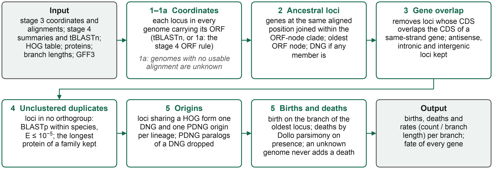

# 06 Summary stage, births, deaths and rates



Stage 4 classifies loci one reference species at a time, so a gene born in an ancestor appears once in every descendant
species. The summary stage (`5_birth_death/`) turns these per-species calls into events on the tree. It joins genes of
different species that sit at the same aligned position into one ancestral locus, removes loci whose coding exons
overlap another gene on the same strand, collapses duplicated loci into one origin, places each birth on the branch of
its ORF node, counts deaths by Dollo parsimony (the gene was born once and lost wherever its descendants lack the ORF),
and divides births and deaths by branch length to give rates per million years.

## The example

The example reads the stage 4 output of [05 Enablers](05_stage4_enablers.md) from `tutorial_runs/stage4/`, so run that
page first. `5_birth_death/example_data/` adds what stage 4 does not have.

| File | What it is |
|---|---|
| `stage5_example.conf` | the configuration, every input path and setting of the run |
| `hogs_subset.tsv` | the three rows of the paper's OrthoFinder HOG table (`N0.tsv`) that hold a tutorial gene |
| `Arabidopsis_thaliana_subset.gff3`, `gff_table.tsv` | the *A. thaliana* annotation within 30 kb of the loci, for the overlap step |
| `expected/` | the expected output |

Branch lengths come from `5_birth_death/data/branch_lengths_brassicaceae.tsv`, the time-calibrated tree of the paper (in
million years).

## Run

```bash
bash 5_birth_death/run_stage5.sh 5_birth_death/example_data/stage5_example.conf
```

It runs steps 1 to 5 in a few seconds and ends with `SUCCEEDED steps 1-5`.

## Check that it worked

```bash
for f in gene_status origins overlap rates_by_branch; do
  cmp tutorial_runs/stage5/$f.tsv 5_birth_death/example_data/expected/$f.tsv && echo "$f OK"
done
cat tutorial_runs/stage5/origins.tsv
```

```
HOG             Gene_type  birth_branch          death_branches        loci
SINGLETON_C1    DNG        N6                    Boechera_stricta;N17  1
N0.HOG0018191   PDNG       N9                    N12                   1
SINGLETON_C3    PDNG       N9                    N12                   1
SINGLETON_C4    PDNG       N9                    Arabidopsis_halleri   1
N0.HOG0019379   DNG        Arabidopsis_thaliana                        1
SINGLETON_C6    PDNG       Arabidopsis_thaliana                        1
```

*PLDRP1* (`SINGLETON_C1`) was born on the branch leading to N6 and lost twice, in *Boechera stricta* and in the
ancestor of the two *Capsella* species (N17). The three N9 PDNGs were born in the ancestor of the three *Arabidopsis*
species; two of them were lost in the ancestor of *A. lyrata* and *A. halleri* (N12), and *POLARIS* only in
*A. halleri*. AT1G18975.1 is absent, because stage 4 removed it.

## Output

| File | What it holds |
|---|---|
| `rates_by_branch.tsv` | **the result**, one row per branch with its length, DNG, PDNG and total (TDNG) births and deaths, and their rates (count divided by length) |
| `origins.tsv` | one row per counted origin, with its HOG (or `SINGLETON_` when the locus is in no orthogroup), type, birth branch, death branches and number of loci |
| `gene_status.tsv` | every gene, its locus, its HOG unit and why it is counted or not |
| `overlap.tsv` | the position of every locus relative to its neighboring genes (`intergenic`, `divergent`, `convergent`, `antisense_overlap`, `same_strand_cds_overlap` and so on) |
| `loci.tsv`, `genes.tsv`, `coords.tsv`, `presence/`, `unclustered/` | intermediate tables of steps 1 to 4 |
| `STATUS`, `stepN.log` | the verdict and the log of each step |

## How the example differs from the paper

The example has one species, so each locus stays on its own. In the paper, genes of all 20 species are joined, and two
of the tutorial genes share a HOG with loci of other species. Five of the six origins match the paper exactly (same
birth and death branches), and the overlap classes of all six genes are the paper's. *TWISTED1* (`N0.HOG0018191`) is the
exception. In the paper its HOG holds older loci of other species, and the origin is dated to N4, not N9.

## On your own data

1. Copy `5_birth_death/config/stage5.conf.example` and set the paths to your stage 3 and stage 4 outputs, the HOG table
   of stage 1, the candidate proteins, a branch-length table (`branch`, `length` in million years, from a time-calibrated
   tree) and a GFF table (`species`, `gff`, optionally `fai`) with one GFF3 per species. Paths inside the GFF table are
   read relative to the table itself.
2. A species without an annotation can be counted without the overlap check by naming it in `NO_GFF_SPECIES`.
3. Each step refuses to overwrite its output, so a rerun goes to a new `OUTDIR`. `OUTDIR` must not contain spaces when
   step 4 runs, because BLAST+ cannot use such paths.
4. The settings that change counts (`HOG_SPAN`, `EXCLUDE_OVERLAP`, `PRESENCE`, `HOG_ID_MATCH`) are explained under
   "Rules" in the stage README, with the values the paper used.

Stage README, [`5_birth_death/README.md`](../../5_birth_death/README.md).
Next, [07 Your own clade](07_your_own_clade.md).
