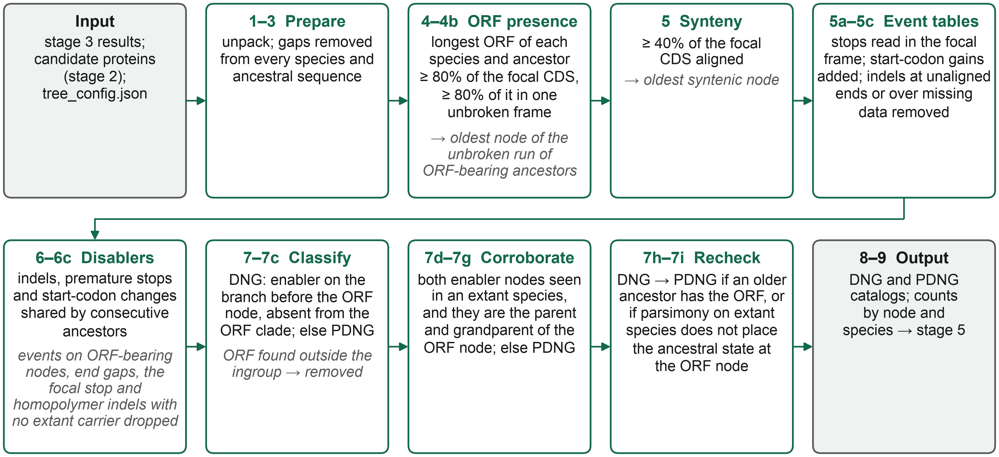

# LINGUA tutorial

This tutorial walks through LINGUA one stage at a time on small worked examples that run in seconds on a laptop or a
lab workstation. Each page explains what the stage does, what goes in, the exact commands, what every output file means
and how to tell that the run worked. The examples for stages 3 to 5 are real loci from the Brassicaceae analysis of
the paper, so each result can be compared with the published catalog.

*Stage 4, the step that places enablers and classifies DNGs and PDNGs. Every stage has a figure like this one at the top
of its README and of its tutorial page.*

## Pages

| Page | Stage | Worked example | Run time |
|---|---|---|---|
| [00 Setup](00_setup.md) | all | install one conda environment, get the code | 5 to 10 min |
| [01 Proteins](01_stage0_proteins.md) | 0, protein preprocessing | three species (*A. thaliana*, *A. lyrata*, *B. oleracea*), real proteomes | under a minute |
| [02 Gene stratigraphy](02_stage1_stratigraphy.md) | 1, candidates from OrthoFinder | two synthetic species with a precomputed OrthoFinder run | seconds |
| [03 Homolog exclusion](03_stage2_homolog_exclusion.md) | 2, homology screens | eight hand-built candidates, each removed for a known reason | seconds |
| [04 Alignment extraction](04_stage3_alignment_extraction.md) | 3, loci from the Cactus alignment | seven *A. thaliana* candidates from the paper | about a minute |
| [05 Enablers](05_stage4_enablers.md) | 4, DNG or PDNG | the same seven candidates | seconds |
| [06 Births and deaths](06_stage5_birth_death.md) | summary stage, rates per branch | the stage 4 result of the seven candidates | seconds |
| [07 Your own clade](07_your_own_clade.md) | all | what to change for another group of species | |
| [08 Troubleshooting](08_troubleshooting.md) | all | errors seen in real runs and what they mean | |

Read the pages in order the first time. Stages 3, 4 and the summary stage use the same seven genes, so the story of each
gene can be followed from its alignment to the branch where it was born.

## The seven example genes

| Gene | Name | Paper classification |
|---|---|---|
| AT5G39570.2 | *PLDRP1* | DNG, ORF born at N6 |
| AT1G31835.2 | | DNG, ORF born on the *A. thaliana* branch |
| AT4G39403.1 | *POLARIS* | PDNG, ORF at N9 |
| AT2G32275.1 | *TWISTED1* | PDNG, ORF at N9 |
| AT4G24920.2 | | PDNG, ORF at N9 |
| AT3G30720.1 | *QQS* | PDNG, ORF on the *A. thaliana* branch |
| AT1G18975.1 | | removed by stage 4, because the ORF is also present outside the Brassicaceae |

Node labels (N0 to N21) are those of `4_enablers/data/SpeciesTree_rooted_node_labels_oct_16.txt`. N9 is the ancestor of
*A. thaliana*, *A. lyrata* and *A. halleri*; N6 adds *Capsella*, *Camelina* and *Boechera*.

## Conventions

- Every command is run from the top folder of the repository (`LINGUA/`), unless a page says otherwise.
- Every example writes into `tutorial_runs/`, which git ignores. Delete that folder to start again.
- Each stage refuses to overwrite its own output. To rerun a stage, move or delete its folder in `tutorial_runs/` first.
- Expected results are stored next to each example (`example_data/expected/` or `example_data/test_run/`), and each page
  gives the command that compares your output with them.

## Where the example data came from

The stage 0 to 2 examples were already part of each stage. The stage 3 to 5 examples were cut from the final run of the
paper (32,210 lineage-specific genes, LINGUA v1.2.0), namely the stage 3 step 1 extractions of the seven loci, the
stage 3 outputs that stage 4 read, their candidate proteins, three rows of the OrthoFinder HOG table and the
*A. thaliana* Araport11 annotation within 30 kb of the loci. Stage 4 on the example reproduces the paper's rows for all
seven genes exactly.
